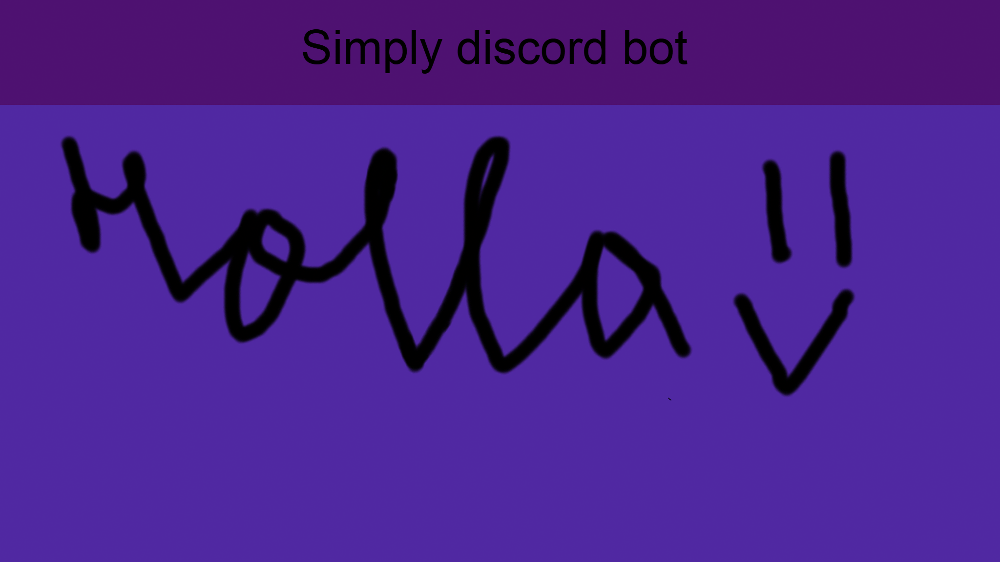

<p align="center">
  
</p>

# Simply discord Bot

<p align="center">
  <a href="https://discord.gg/VsQQbXb8y"></a>
  <a href="LICENSE"></a>
  <a href=""></a>
</p>

---

Bot de Discord en Python con comandos de prefijo `!`, consejos ambientales y
reproducción de música.

## Requisitos

- Windows
- Python 3.10 o posterior
- Una aplicación de bot creada en el
  [Discord Developer Portal](https://discord.com/developers/applications)
- FFmpeg. Este proyecto incluye `bin\ffmpeg.exe`; ejecuta el bot desde la
  carpeta del proyecto para que lo encuentre.

## Instalación

Abre PowerShell en la carpeta del proyecto y ejecuta:

```powershell
py -3 -m venv .venv
.\.venv\Scripts\Activate.ps1
python -m pip install --upgrade pip
python -m pip install "discord.py[voice]" requests yt-dlp
```

Si PowerShell bloquea la activación del entorno virtual, puedes ejecutar los
comandos de instalación sin activarlo:

```powershell
.\.venv\Scripts\python.exe -m pip install --upgrade pip
.\.venv\Scripts\python.exe -m pip install "discord.py[voice]" requests yt-dlp
```

## Configuración de Discord

1. En el Developer Portal, crea una aplicación y añade un bot.
2. Copia el token del bot y guárdalo de forma privada en el archivo `.env` que
   está junto a `main.py`. No publiques ni compartas ese archivo.
3. En **Bot > Privileged Gateway Intents**, activa **Message Content Intent** y
   **Server Members Intent**.
4. En **OAuth2 > URL Generator**, selecciona el scope `bot` y genera una
   invitación con estos permisos:
   - View Channels
   - Send Messages
   - Read Message History
   - Manage Messages
   - Embed Links
   - Attach Files
   - Connect y Speak (para música)
5. Invita el bot a tu servidor.

Los comandos son de prefijo; no son comandos de aplicación `/`.


## Configuracion de *Api Leage*

1. Ve a [Api leage web](https://apileague.com/) y crea una cuenta y sige los pasos
    - Si ya tienes una cuenta inicia secion en ella

2.  Despues de crear una cuenta ve a la [Api Leage console](https://apileague.com/console/#) y busca por **Profile & API Key**

3. Clikea en **Show / Hide API Key** para ver la api y despues copia la API key mostrada.

4. Implementa la api en el [.env](.env) y pon la api.

- Ahora puedes usar el comando `!mems online`

### Variables de entorno

`main.py` lee las variables `TOKEN` y `TOKEN_APIS_LEAGE` del entorno del
proceso. Tenerlas escritas en `.env` no basta por sí solo: el programa no carga
ese archivo automáticamente. El formato esperado es una variable por línea:

```js
TOKEN=tu_token_del_bot
TOKEN_APIS_LEAGE=tu_clave_de_apileague
```

Desde PowerShell, en la carpeta del proyecto, puedes cargar el `.env` para la
sesión actual e iniciar el bot sin imprimir sus valores:

```powershell
Get-Content .env | ForEach-Object {
    if ($_ -match '^\s*([^#=]+)=(.*)$') {
        [Environment]::SetEnvironmentVariable(
            $matches[1].Trim(),
            $matches[2].Trim().Trim('"'),
            'Process'
        )
    }
}

python main.py
```

La clave `TOKEN_APIS_LEAGE` se usa para los memes en línea (`!mems online`).
El resto del bot puede funcionar sin esa clave. No subas `.env` a GitHub.

## Iniciar el bot

Cada vez que abras una nueva terminal, activa el entorno virtual y carga las
variables antes de ejecutarlo:

```powershell
.\.venv\Scripts\Activate.ps1
```

Después ejecuta el bloque de carga de `.env` de la sección anterior. Para
detener el bot, pulsa `Ctrl+C`.

## Comandos principales

El prefijo configurado es `!`.

| Comando | Función |
| --- | --- |
| `!help` | Muestra la ayuda |
| `!consejos` | Publica diez consejos ambientales en diez mensajes separados |
| `!clear 200` | Borra hasta 200 mensajes recientes del canal |
| `!limpiar 200` | Alias de `!clear` |
| `!contaminacion` | Explica qué es la contaminación |
| `!mems ambiental` | Envía un meme ambiental de la carpeta `img` |
| `!mems interno` | Envía una imagen de la carpeta `img` |
| `!mems online` | Busca un meme en línea; requiere `TOKEN_APIS_LEAGE` |
| `!play <nombre o URL>` | Busca o reproduce música *(Descontinuado)* |
| `!queue` | Muestra la cola de música |
| `!pause`, `!resume`, `!skip` | Controla la reproducción |
| `!stop`, `!leave` | Detiene la música o desconecta el bot |

`!clear` acepta cantidades de **10 a 1000** y requiere que quien lo usa tenga
el permiso **Manage Messages**. El bot también necesita **Manage Messages** y
**Read Message History** en el canal. La cantidad solicitada incluye el mensaje
que invoca el comando; si hay menos mensajes disponibles, se borrarán los que
haya.


# Fin

Si hiciste todo corectamente el bot deveria de funcionar de forma perfecta!


---

## Problemas comunes

- **El bot no responde:** comprueba que esté en línea, que el prefijo sea `!`,
  que **Message Content Intent** esté activado y que tenga permiso para ver y
  escribir en el canal.
- **Error de token:** verifica que `TOKEN` esté en `.env` y que hayas cargado
  ese archivo en la misma ventana de PowerShell antes de ejecutar `main.py`.
- **No se pueden borrar mensajes:** revisa los permisos **Manage Messages** del
  usuario y del bot, además de **Read Message History** para el bot.
- **Error de música o FFmpeg:** ejecuta `main.py` desde la carpeta del proyecto
  y comprueba que `bin\ffmpeg.exe` exista.
- **El bot no responde a el comando !mems {..}**: Verifica que la api de **Api Leage** este escrita corectamente y que funcione.
    - *Se recomienda checker el .env si el error persiste(o preguntarle a una **AI**)*
